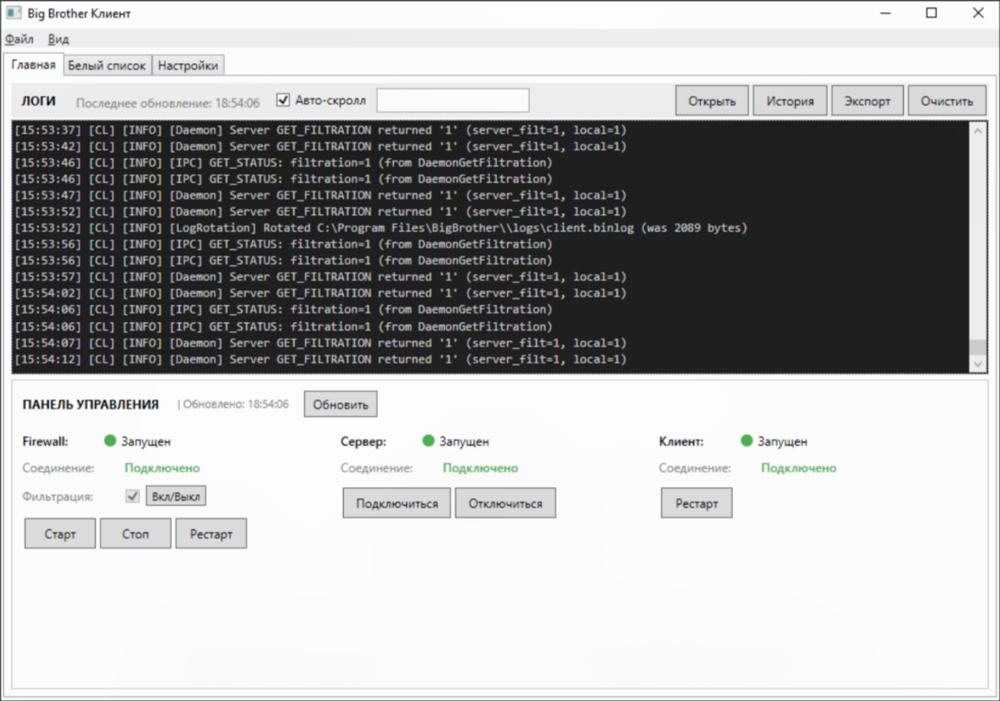
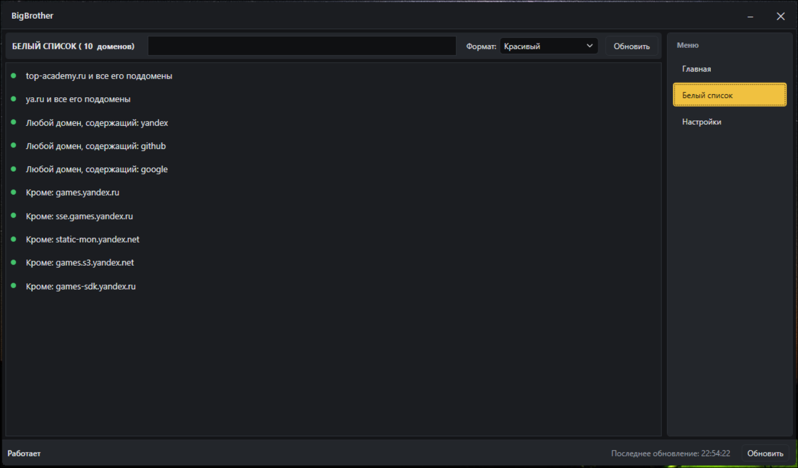
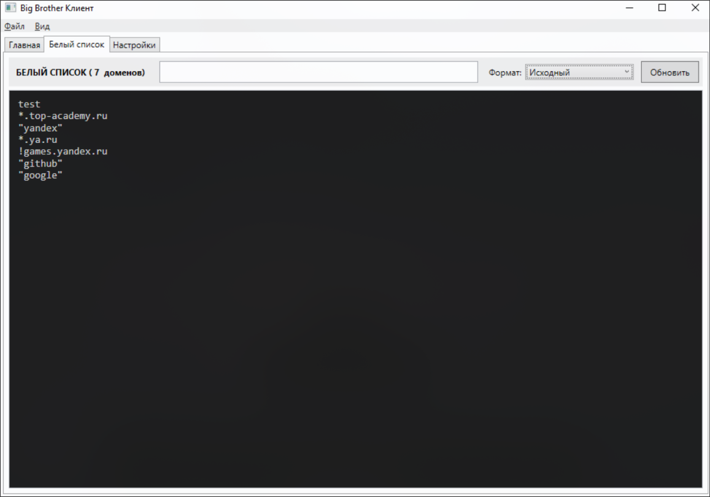
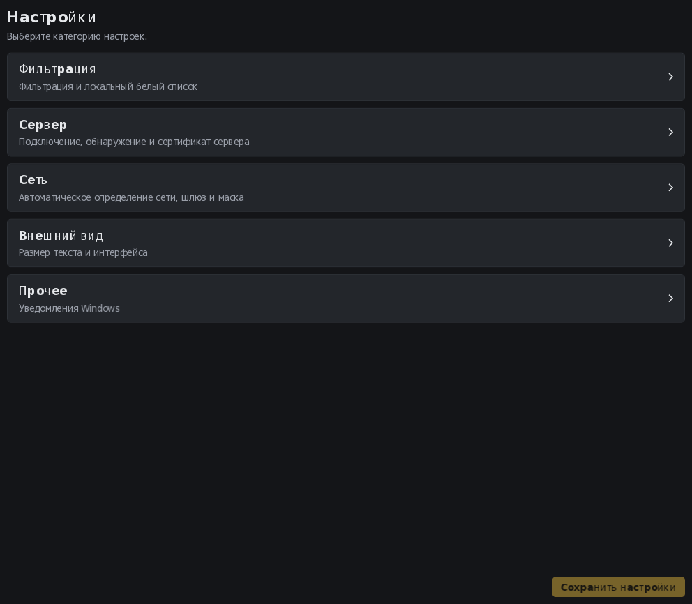
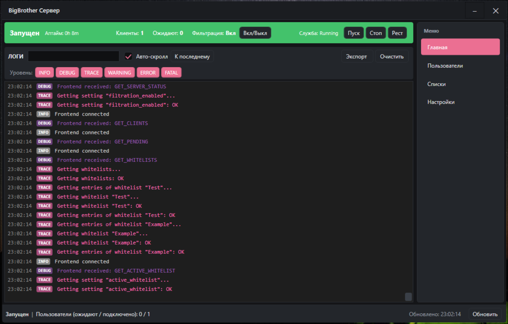
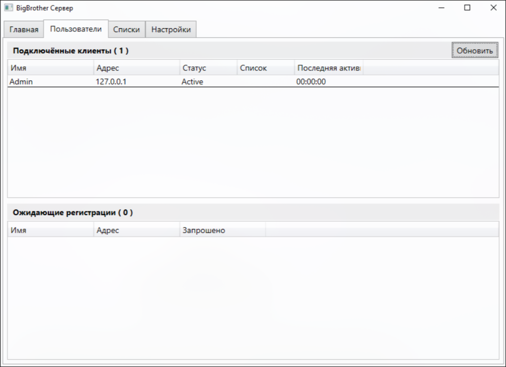
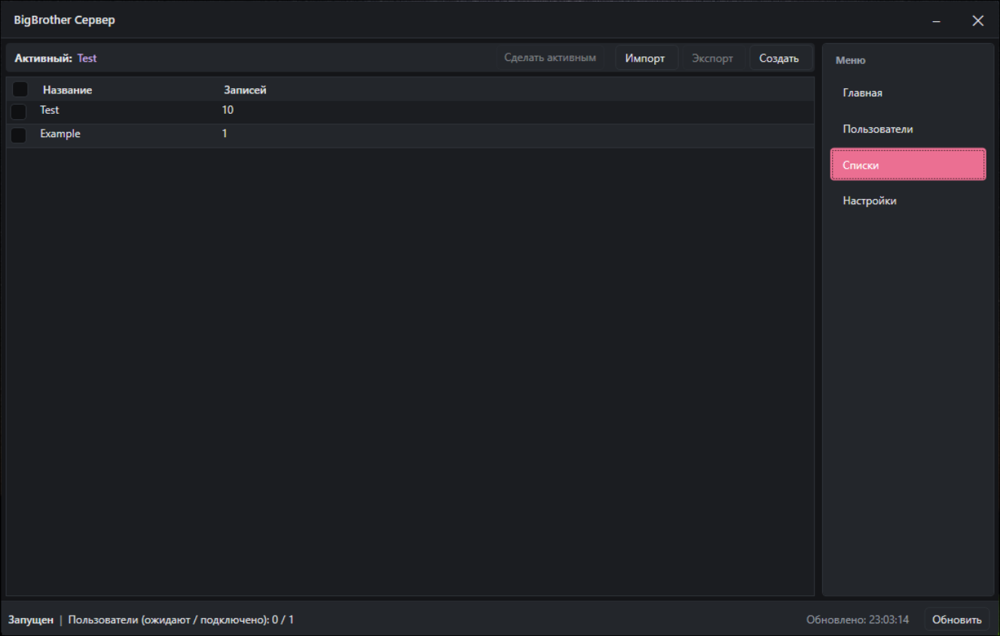
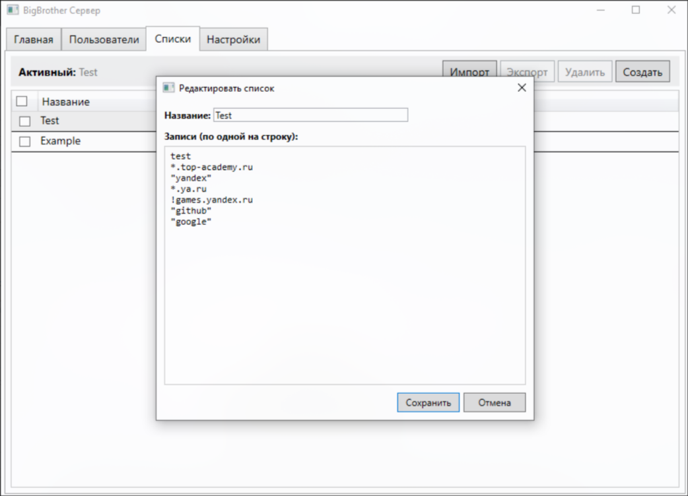
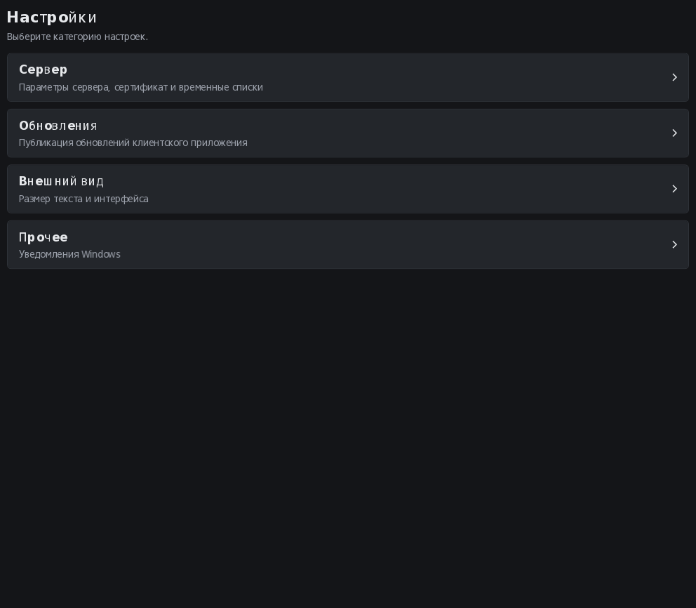

# BigBrother - Пользовательская инструкция

> [!IMPORTANT]
> ЭТА СТРАНИЦА БУДЕТ ОБНОВЛЯТЬСЯ АВТОМАТИЧЕСКИ И СОДЕРЖИТ ИНФОРМАЦИЮ ОТНОСЯЩУЮСЯ К ПОСЛЕДНЕЙ РЕЛИЗНОЙ ВЕРСИИ.

> [!CAUTION]
> **ОЧЕНЬ ВАЖНО: НАСТРОЙТЕ DNS В БРАУЗЕРЕ ДО ВКЛЮЧЕНИЯ ФИЛЬТРАЦИИ.** Принудительный DNS over HTTPS (DoH) скрывает DNS-ответы от Firewall: даже разрешённые сайты могут перестать открываться.
>
> - **Firefox:** выберите **Default Protection** («Защита по умолчанию») или **Off** («Выкл.»). **Increased Protection** и **Max Protection** игнорируют DNS-канарейку; автоматическое отключение DoH в этих режимах не работает.
> - **Chrome, Edge и другие браузеры на Chromium/Blink:** выключите **Use secure DNS** («Использовать безопасный DNS»). **Явный выбор провайдера в этом разделе, включая готовый вариант Google/Cloudflare или собственный DoH URL, принудительно включает DoH без перехода на обычный DNS при ошибке.** Автоматический режим допускает такой переход, но канарейку Firefox не поддерживает и не гарантирует совместимость.
> - Проверьте также системный защищённый DNS, DNS-приложения, VPN и прокси: настройка браузера не отключает их.
>
> После изменения настроек полностью перезапустите браузер. [Настройка, совместимость браузеров и проверка](#sec-browser-dns).

При включённой фильтрации исходящий IPv6-трафик по умолчанию блокируется. Чтобы разрешить его, снимите флажок **Блокировать исходящий IPv6 при включённой фильтрации** в настройках клиента и нажмите **Сохранить настройки**. Эта настройка сохраняется после перезапуска. Белые списки пока поддерживают только IPv4: при снятом флажке IPv6-трафик проходит без проверки по белому списку, а фильтрация IPv4 продолжает работать. При выключенной фильтрации IPv6-трафик проходит свободно.

> [!CAUTION]
> В ДАННЫЙ МОМЕНТ ПРОЕКТ НАХОДИТСЯ В БЕТА-ТЕСТЕ.

## СОДЕРЖАНИЕ

- [1. Вступление](#sec-intro)
- [2. BigBrother Client](#sec-client)
  - [2.1 Главная](#sec-client-main)
  - [2.2 Белый список](#sec-client-wl)
  - [2.3 Настройки](#sec-client-settings)
- [3. BigBrother Server](#sec-server)
  - [3.1 Главная](#sec-server-main)
  - [3.2 Пользователи](#sec-server-users)
  - [3.3 Списки](#sec-server-wls)
  - [3.4 Настройки](#sec-server-settings)
  - [3.5 Схема сети](#sec-server-network)
- [4. Фильтрация](#sec-filtering)
  - [4.1 Белые списки](#sec-filtering-wl)
  - [4.2 Правила](#sec-filtering-rules)
  - [4.3 Особенности](#sec-filtering-features)
    - [4.3.1 DNS и браузеры — очень важно](#sec-browser-dns)
    - [4.3.2 Переключение фильтрации и отзывчивость](#sec-filtering-state)
  - [4.4 Как это работает?](#sec-how-it-works)
- [5. Планы развития](#sec-roadmap)

<a name="sec-intro"></a>
## 1. ВСТУПЛЕНИЕ

**BigBrother** - это распределённый Firewall (межсетевой экран), его основная функция это фильтрация интернет трафика на основе конфигурируемых белых списков. 

> [!CAUTION]
> **Фильтрация не будет работать в сочетании с любым другим приложением, которое как-либо изменяет стандартную маршрутизацию или вмешивается в структуру пакетов.**
> 
> Например: ***Любые Proxy и VPN (В том числе [Cloudflare WARP](https://one.one.one.one)), [Zapret](https://github.com/flowseal/zapret-discord-youtube) и его аналоги.***

> [!CAUTION]
> **Также фильтрация не применяется к локальному трафику, т.е. ко всему входящему/исходящему трафику частных IP адресов определённых в RFC 1918:**
> - Класс А (10.0.0.0 — 10.255.255.255)
> - Класс B (172.16.0.0 — 172.31.255.255)
> - Класс C (192.168.0.0 — 192.168.255.255)
>
> Shared Address Space (100.64.0.0 — 100.127.255.255) определяется в другой спецификации и как следствие является исключением.
>
> P.S. В связи с этой особенность надо проявить осторожность относительно конфигурации ЛВС, - если в ней работает прокси/VPN сервер, через который осуществялется выход в интернет, то при подключении к нему это будет функционировать штатно, в обход фильтрации на клиентском ПК (если на сервере настроена фильтрация, то она при этом будет работать для клиента).  

> [!IMPORTANT]
> **BigBrother** это не одно приложение, а целая система из пяти взаимосвязанных приложений.

Клиентские приложения:

- **BigBrother Firewall** - Основная программа, которая осуществляет **исключительно** фильтрацию трафика. Запускается как служба Windows.

- **BigBrother Client Daemon** - Программа, которая управляет Firewall'ом, через неё происходит взаимодействие с клиентским приложением, связь с сервером и всё прочее, что не связано с фильтрацией трафика. Работает как служба Windows **BigBrother Client**. При её остановке фильтр тоже останавливается, а графический интерфейс остаётся доступным.

- **BigBrother Client** - Программа, предоставляющая графический пользовательский интерфейс (GUI) для взаимодействия с предыдущими двумя программами. Запускается как десктопное приложение.

Серверные приложения:

- **BigBrother Server Daemon** - Программа-сервер, используется для централизированного управления белыми списками. Позволяет, управлять подключениями клиентов, добавлять/удалять/редактировать белые списки, правила в них, а также устанавливать активный белый список из числа существующих. Запускается как служба Windows.

- **BigBrother Server** - Программа, предоставляющая графический пользовательский интерфейс (GUI) для взаимодействия с серверным приложением. Запускается как десктопное приложение.

Клиентские приложения устанавливаются на ПК, для которого требуется настроить фильтрацию. Серверные приложения устанавливаются на ПК, который будет выступать в качестве сервера. Установка производится с помощью отдельных установщиков: **BigBrother Client Setup** (клиентская часть) и **BigBrother Server Setup** (серверная часть). **Для того, чтобы система работала, необходимо чтобы сервер и все клиенты были в одной локальной сети.**

Как пользователь/администратор вы будете взаимодействовать напрямую только с двумя программами из этого списка, в основном это будет **BigBrother Server**, т.к. вся фильтрация настраивается на сервере, а клиенты просто синхронизируют свои настройки с ним. Если же потребуется какая-либо доп. настройка или же возникнут проблемы на клиентском ПК, тогда потребуется использовать **BigBrother Client**.

Строго говоря, серверные приложения не являются обязательными для работы **BigBrother**, однако **BigBrother Client** не предоставляет функционала для управления белыми списками и правилами в них. Единственный способ управлять активным белым списком при таком раскладе является настройка, позволяющая использовать белый список из файла **whitelist.txt**, если нет соединения с сервером. В целом, подобный подход стоит рассматривать исключительно как экстренную меру.

Суммируя, можно сказать, что **использовать BigBrother без серверной части не имеет смысла, несмотря на наличие такой возможности.**

Сообщения, подтверждения и запросы учётных данных в обоих приложениях используют общее оформление и выбранные размеры шрифтов. Текст сообщений можно выделять и копировать; длинные сообщения прокручиваются. Enter активирует выбранную кнопку, Esc или крестик закрывают сообщение без подтверждения действия. Окна открытия и сохранения файлов остаются стандартными окнами Windows.

<a name="sec-client"></a>
## 2. BigBrother Client

<a name="sec-client-main"></a>
### 2.1 Главная

Как было сказанно в вступлении - взаимодействовать вам придётся только с двумя программами, первая из них это **BigBrother Client**, открыть его можно либо через меню **Пуск**, либо через ярлык на рабочем столе (если он не был удалён). При его запуске вы увидите следующее окно:

Служба **BigBrother Client** управляет остальными клиентскими приложениями.
Открытие интерфейса не запускает службы: если клиентская служба остановлена,
интерфейс показывает отсутствие связи. На главной странице в панели управления
есть отдельные группы **Клиентская служба** и **Firewall**, каждая с кнопками
**Старт**, **Стоп** и **Рестарт**. Сначала запустите клиентскую службу, затем при
необходимости — Firewall. Запуск клиентской службы сам по себе не запускает фильтр.
Кнопки управления Firewall доступны только при связи с клиентской службой;
остановить или перезапустить саму службу можно и при отсутствии этой связи.
Во время операции кнопки временно недоступны, ошибки отображаются в журнале.
Остановка или аварийное завершение службы останавливает фильтр; интерфейс остаётся
открытым и показывает отсутствие связи. После перезапуска службы фильтр остаётся остановленным до явной команды
запуска. Для перехода со старой версии, где фильтр запускал клиентскую службу,
один раз используйте полный установщик **BigBrother Client Setup**.



*Не обращайте внимание на логи, приложение на скриншоте запущено в режиме разработчика.*

В окне есть несколько вкладок, по умолчанию открыта **Главная**, здесь отображаются логи (последние несколько сотен), а главное здесь показаны статусы: Firewall'а, фонового клиентского приложения с которым вы и взаимодействуете через эту программу, а также статус подключения к серверу. 

**Перед включением фильтрации обязательно выполните [настройку DNS в браузере](#sec-browser-dns).**

Также здесь представлены кнопки для управления всем вышеперечисленным. Помимо прочего есть опция, позволяющая остановить фильтрацию без остановки самого Firewall'а. Это полезно, т.к. при остановке Firewall'а фоновое клиентское приложение также остановится автоматически. А поскольку именно к нему мы подключаемся для взаимодействия с системой, то при его остановке у нас не будет возможности настроить клиентскую часть или даже просто просмотреть состояние приложений. 

<a name="sec-client-wl"></a>
## 2.2 Белый список

На второй вкладке находится активный белый список.



Есть два формата представления, первый, который используется на скриншоте выше - **Красивый**, он представляет список в человекочитаемом формате, второй - **Исходный** показывает список в исходном формате, к примеру:



В данном случае показаны именно сами исходные правила в белом списке, как они записанны на сервере. 

<a name="sec-client-settings"></a>
## 2.3 Настройки

На последней вкладке находятся настройки всей клиентской части.

При открытии вкладки сначала отображаются категории:

- **Фильтрация** — разделы **Фильтрация** и **Белый список**.
- **Сервер** — разделы **Сервер**, **Обнаружение сервера** и **Сертификат сервера**.
- **Сеть** — раздел **Сеть**.
- **Внешний вид** — размер текста и интерфейса.
- **Прочее** — раздел **Уведомления**.

Откройте нужную категорию. Кнопка **Все категории** или **Esc** возвращает к выбору; при повторном открытии вкладки снова показывается список категорий. Переход между категориями сохраняет несохранённые изменения. Одна общая кнопка **Сохранить настройки** доступна и в обзоре категорий, и внутри каждой категории. Она сохраняет все изменённые параметры, включая размеры шрифтов; подсказка о несохранённых изменениях учитывает также внешний вид.

<a name="sec-appearance"></a>
В категории **Внешний вид** доступны два независимых размера шрифта:

- **Размер текста** — логи и их история, правила белых списков, содержимое таблиц и поля ввода, включая редактор белого списка на сервере.
- **Размер интерфейса** — подписи, кнопки, меню, заголовки и элементы управления окнами.

Для каждого размера доступны ввод числа и кнопки **−** / **+**. Введённое число применяется по **Enter** или после выхода из поля; клавиши **↑** / **↓** меняют его на один шаг, **Esc** отменяет незавершённый ввод. Диапазон — от **10 до 28 px**, значение по умолчанию — **14 px**. Пропорции внутри каждой группы сохраняются. Размеры меняются сразу для предварительного просмотра; чтобы использовать их после перезапуска, нажмите общую кнопку **Сохранить настройки**. Она также применяет ещё не подтверждённые значения в полях размеров. Кнопка **По умолчанию (14 px)** сбрасывает оба размера, после чего изменения нужно сохранить.

Настройки внешнего вида клиента и сервера сохраняются отдельно. При переходе с единого базового размера оба новых размера получают его сохранённое значение.

Тонкая серая рамка выделяет границы основных и дополнительных окон в плавающем режиме, в том числе когда окно открыто поверх другого окна приложения. Углы окна и рамки прямые, поэтому контур остаётся непрерывным. При разворачивании окна рамка скрывается; после восстановления плавающего размера появляется снова.

Главные окна клиента и сервера запускаются развёрнутыми в рабочей области монитора, сохраняя доступ к панели задач. Кнопка восстановления в заголовке возвращает окно в плавающий режим: начальный размер — 1560×910 у клиента и 1430×910 у сервера.



В категории **Сервер** находятся параметры подключения, автоматического обнаружения и проверки сертификата. В разделе **Сервер** доступны следующие поля:

- **Адрес сервера** - IP адрес сервера к которому вы подключаетесь. Можно настроить вручную, либо автоматически.
- **Пользователь** - Ваше имя для сервера, рекомендуется выставить в соответствии с именем вашего ПК (его можно узнать в Сведениях о системе). 
- **Порт** - Порт, на котором работает сервер по указанному адресу, по умолчанию это 1984.
- **Сервер** - Если вы подключены к серверу, то здесь будет показано его имя и IP адрес.

По умолчанию почти все эти поля пустые, если у вас они уже заполнены, то не редактируйте их, если не понимаете что делаете. Чтобы сменить/установить сервер в автоматическом режиме нужно нажать кнопку **Сменить**, нажать надо 1 раз и подождать какое-то время (~5 секунд), далее у вас появится список со всеми найденными серверами, просто выберите один из них. После этого поля **Адрес сервера** и **Порт** изменятся автоматически. Если вы хотите настроить это вручную, то измените поля и нажмите **Сохранить настройки**.

После этого, если вы уже зарегистрированы на сервере, то подключение произойдёт автоматически и белый список обновится. Если вы незарегистрированы, то после ввода имени в графу **Пользователь** нужно нажать **Сохранить настройки**, а потом **Зарегистрироваться**. Как только на сервере будет одобрена заявка на регистрацию вы подключитесь автоматически.

В блоке **Фильтрация** есть опция **Синхронизировать фильтрацию с подключением к серверу** (включена по умолчанию). Когда она включена, фильтрация активна только при подключении к серверу: при потере соединения (по любой причине) фильтрация на этом клиенте автоматически отключается, а при восстановлении — включается обратно. Это позволяет избежать ситуации, когда клиент остаётся с последним полученным белым списком и не может получить новые правила. Если вы отключите фильтрацию вручную кнопкой **Вкл/Выкл**, она останется отключённой, пока вы не включите её снова.

<a name="sec-server"></a>
## 3. BigBrother Server

<a name="sec-server-main"></a>
### 3.1 Главная 

Второе приложение, с которым вы будете работать большую часть времени (а если повезёт, то только с ним) это **BigBrother Server**. Именно через него происходит управление белыми списками, при запуске вы увидите следующее окно:



*Не обращайте внимание на логи, приложение на скриншоте запущено в режиме разработчика.*

В окне есть несколько вкладок, по умолчанию открыта **Главная**, здесь отображаются логи (последние несколько сотен), а главное здесь показан статус сервера и службы, кол-во активных клиентов и заявок на регистрацию, а также статус фильтрации и аптайм (время работы) сервера. Помимо прочего здесь представлены кнопки для управления службой и кнопка включения/выключения фильтрации. 

Также как и **BigBrother Client** это приложение является просто интерфейсом к соответствующей программе, поэтому при его выключении вы потеряете доступ к настройкам (т.к. фактически настройки выставляет именно **BigBrother Server Daemon**, вы просто "говорите" ему что сделать, а если он не запущен, то и выставлять настройки некому).

<a name="sec-server-users"></a>
### 3.2 Пользователи



На вкладке **Пользователи** отображаются все подключенные пользователи, а также заявки на регистрацию. Указывается имя пользователя и его IP адрес.

Фильтр **Все пользователи** объединяет всех зарегистрированных клиентов, включая отключённых, и ожидающие заявки. В колонке **Состояние** указано, подключён ли клиент или ожидает регистрации. Время последней активности показывается для подключённых клиентов, время заявки — для ожидающих. Поиск, флажки и выделение диапазона работают и в этом режиме; отметки сохраняются при подключении и отключении клиента.

Колонка **Белый список** показывает, совпадают ли правила в Firewall клиента с текущим общим списком активных правил сервера: **Актуален** или **Устарел**. **Недоступен** означает, что клиент не смог прочитать правила Firewall; **Нет данных** отображается до первого отчёта или для старых версий клиента.

**Фильтрация** показывает фактическое состояние фильтрации на клиенте. **Блокировка IPv6** показывает сохранённое предпочтение клиента; оно действует только при включённой фильтрации. **Последняя активность** — локальные дата и время последнего подключения или сигнала от клиента. Клиенты отправляют отчёты каждые 10 секунд, таблица также обновляется каждые 10 секунд.

Управление пользователями и заявками на регистрацию осуществляется через контекстное меню (открывается кликом ПКМ по записи).

Флажки слева отмечают пользователей для групповых действий; флажок в заголовке отмечает всех клиентов или все заявки, включая скрытые поиском. Ctrl-клик переключает флажок строки, Shift-клик отмечает диапазон в текущем порядке сортировки, Ctrl+Shift добавляет диапазон к уже отмеченным. Отмеченные строки подсвечиваются и сохраняют отметки при обновлении. Команды контекстного меню применяются ко всем отмеченным строкам, а если отметок нет — к текущей строке; после запуска действия отметки снимаются. Для просмотра токенов используется одно общее окно.

В режиме **Все пользователи** каждая команда применяется к подходящим отмеченным строкам: одобрение и отклонение — к заявкам, просмотр и сброс токенов — к зарегистрированным клиентам, отключение и управление IPv6 — к подключённым клиентам. Если подходящих строк нет, команда недоступна.

Отдельные команды **Отключить блокировку IPv6** и **Включить блокировку IPv6** устанавливают и сохраняют выбранное состояние у всех отмеченных клиентов, независимо от их текущих настроек. Если отметок нет, команда применяется к текущему клиенту. Блокировка действует при включённой фильтрации; при отключённой блокировке IPv6 проходит без проверки по белому списку. Сервер обновляет таблицу по отчётам клиентов и пишет результат для каждого в журнал; если клиент не подтвердил изменение, появляется ошибка. Команды недоступны, если хотя бы один выбранный клиент не поддерживает удалённое управление IPv6 или ещё не прислал первый отчёт.

Обновление происходит автоматически с определённым интервалом, также это можно сделать нажав по кнопке **Обновить**.

<a name="sec-server-wls"></a>
### 3.3 Списки



На вкладке **Списки** выпадающее меню **Активных списков: N** / **Активных временных списков: N** переключает таблицы обычных и временных списков. Каждый счётчик показывает количество включённых списков соответствующего типа; несколько списков могут быть активны одновременно, их правила объединяются для клиентов. Отдельные команды контекстного меню **Выключить** и **Включить** устанавливают выбранное состояние у всех отмеченных списков, а если отметок нет — у текущего списка. Изменения активности применяются после нажатия **Сохранить**; **Отмена** восстанавливает сохранённые состояния. На вкладке также доступны создание, импорт, экспорт и удаление списков.

Верхняя панель разделена на три группы: **Списки** — создание, импорт и экспорт; **Пресеты** — сохранение и загрузка набора активных списков; **Инструменты** — проверка домена и синхронизация клиентов. При увеличении шрифта или уменьшении окна группы и кнопки переносятся на следующую строку.

Кнопки **Сохранить** и **Отмена** для изменений активности появляются под таблицей только при наличии несохранённого выбора. Проверка домена, синхронизация и список конфликтов используют сохранённые правила.

В группе **Пресеты** кнопка **Сохранить** сохраняет текущий выбор обычных и временных списков, включая несохранённые изменения. Кнопка **Загрузить ▾** открывает поиск пресетов с просмотром и удалением; выбор пресета сразу применяет его и заменяет несохранённый выбор активности.

Временные списки создаются и импортируются в режиме **Активных временных списков**. Новый временный список выключен, его начальное время — 15 минут. В контекстном меню **Таймер…** можно изменить начальное время, оставшееся время и включить **Удалять список после истечения времени**. Время вводится в формате **чч:мм:сс**; количество часов может превышать 23.

Таймер идёт только у включённого временного списка, в том числе при закрытом интерфейсе сервера. Выключение приостанавливает отсчёт, включение продолжает его. После истечения времени список автоматически выключается и, если настроено автоудаление, удаляется вместе с правилами; клиенты получают обновлённый общий список. Повторное включение истёкшего списка запускает таймер с начального времени. Команда **Сбросить таймер** восстанавливает начальное время у отмеченных временных списков или у текущего, если отметок нет, сохраняя их активность.

Начальное и оставшееся время можно менять без выключения списка. Например, если из 15 минут осталось 12, увеличение начального времени до 20 минут даст 17 оставшихся минут. Уменьшение начального времени на 5 минут при остатке 3 минуты завершит таймер сразу. Явное изменение оставшегося времени задаёт его напрямую, допускает значение больше начального и не меняет начальное время; ноль завершает таймер сразу.

Если открыть белый список (ПКМ -> Редактировать) то откроется окно в котором можно сменить имя списка, а также все действующие правила.



<a name="sec-server-settings"></a>
### 3.4 Настройки

На вкладке **Настройки** указываются имя сервера (его видят клиенты), порт и другие параметры сервера.

Сначала отображаются категории:

- **Сервер** — разделы **Сервер**, **Сертификат сервера** и **Временные списки**.
- **Обновления** — раздел **Обновления клиентов**.
- **Внешний вид** — размер текста и интерфейса.
- **Прочее** — раздел **Уведомления**.

Кнопка **Все категории** или **Esc** возвращает к выбору категории. При повторном открытии вкладки отображается обзор категорий. Несохранённые изменения сохраняются при переходах; одна общая кнопка **Сохранить настройки** доступна как в обзоре, так и внутри категорий и сохраняет все изменённые параметры, включая размеры шрифтов. Для публикации или удаления обновления используйте отдельные команды в категории **Обновления**.

В категории **Внешний вид** независимо настраиваются [размер текста и размер интерфейса](#sec-appearance). Они применяются ко всем окнам серверного приложения, включая редактор белых списков, и сохраняются отдельно от настроек клиента.

В блоке **Временные списки** настройка **Сохранять состояние временных списков при остановке сервера** по умолчанию выключена. Если её включить и сохранить настройки, при штатной остановке фонового сервера сохраняются активность и оставшееся время временных списков. При следующем запуске они восстанавливаются; время остановки не вычитается. Если настройка выключена, при запуске все временные списки выключены, таймеры сброшены до начального времени. Названия, правила, начальное время и настройка автоудаления сохраняются в обоих случаях.

> [!CAUTION]
> **НЕ МЕНЯЙТЕ ПОРТ БЕЗ КРИТИЧЕСКОЙ НЕОБХОДИМОСТИ. ПРИ УСТАНОВКЕ BigBrother ДОБАВЛЯЮТСЯ ПРАВИЛА В БРЭНДМАУЭР WINDOWS, КОТОРЫЕ РАЗРЕШАЮТ ПОДКЛЮЧЕНИЯ ДЛЯ ПОРТА ПО УМОЛЧАНИЮ (1984), ЕСЛИ ИЗМЕНИТЬ ПОРТ, ТО ТАКЖЕ НЕОБХОДИМО ОБНОВИТЬ ЭТИ ПРАВИЛА, ИНАЧЕ КЛИЕНТЫ МОГУТ НЕ ИМЕТЬ ВОЗМОЖЕНОСТИ ПОДКЛЮЧИТЬСЯ К СЕРВЕРУ**



<a name="sec-server-network"></a>
### 3.5 Схема сети

Вкладка **Схема сети** показывает сервер, всех зарегистрированных клиентов, включая отключённых, и заявки на регистрацию. На каждом компактном узле указаны имя и адрес, у клиентов — состояние подключения и строка **Фильтрация: Вкл / Выкл** по последнему отчёту клиента. Если клиент отключён, его отчёт недоступен или связь с сервером потеряна, показано **Фильтрация: Нет данных**. У сервера показан один локальный IPv4-адрес; полный текст длинных имён и адресов доступен при наведении на узел. Тёмный фон с точечной сеткой помогает ориентироваться при перемещении схемы; сетка перемещается и масштабируется вместе с узлами.

Перетаскивайте узлы мышью, чтобы повторить расположение компьютеров в кабинете. Узлы можно перемещать влево и вверх за исходное начало схемы; область автоматически расширяется. Можно выбрать узел и перемещать его стрелками с шагом 10 пикселей, а с **Shift** — 1 пиксель. **Esc** отменяет текущее перетаскивание. Позиции сохраняются автоматически для текущего пользователя Windows в `%LOCALAPPDATA%\BigBrother\Server\network-layout.json` и восстанавливаются при следующем запуске. Обновление статуса и смена адреса клиента не меняют его позицию; расположение связано с именем клиента.

Рамка подключённого клиента с отключённой фильтрацией показана оранжевым, остальных подключённых клиентов — зелёным, отключённых — красным. Текст состояния подключения остаётся зелёным или красным; у заявки или неизвестного состояния рамка нейтральная, статус серый. При потере связи с фоновым сервером приложение возвращается на главную страницу с кнопками управления службой. Все вкладки меню, кроме **Главной**, включая **Схему сети**, недоступны до восстановления связи; после подключения статусы обновляются автоматически, а сохранённые позиции узлов восстанавливаются.

**Ctrl + колесо мыши вверх/вниз** увеличивает/уменьшает масштаб относительно указателя. Текущий масштаб показан в процентах; доступен диапазон от 10% до 200%. **100%** возвращает исходный размер, **Вписать** показывает всю схему в доступной области. Чтобы переместить вид, удерживайте левую кнопку мыши на свободном фоне и перетаскивайте схему. Это работает и для схемы, которая целиком помещается в окне; границы перемещения допускают свободное пространство до половины видимой области с каждой стороны. Перемещение вида не меняет сохранённые позиции узлов; **Esc** отменяет текущее перемещение. **Сбросить расположение** заново размещает все узлы сеткой, сохраняет полученное расположение и вписывает схему в окно.

<a name="sec-filtering"></a>
## 4 ФИЛЬТРАЦИЯ

<a name="sec-filtering-wl"></a>
## 4.1 БЕЛЫЕ СПИСКИ

Белые списки состоят из двух частей - имя списка и набора правил в нём (пример на втором скриншоте в разделе 3.3).

Списки можно экспортировать и импортировать в файлы с расширением .wl (например - main.wl). Сами файлы представляют собой набор правил в исходном виде, т.е. это обычный текстовый файл. 

В окне создания или редактирования списка проверка выполняется при вводе. Ошибки содержат номера строк: неверный формат, повтор правила (без учёта регистра) или одинаковые разрешение и исключение. Пока есть ошибки, сохранить список нельзя. Пустой список допустим и не разрешает адреса. Пустые строки и комментарии, начинающиеся с `#` или `;`, не сохраняются как правила. Импорт также отклоняет списки с ошибками до их создания.

Слева от правил отображаются номера строк, включая пустые строки и комментарии. Номера обновляются при редактировании и прокрутке; длинные правила прокручиваются горизонтально. Строки с ошибками подсвечиваются красным фоном, с предупреждениями — янтарным; при наличии обоих типов сообщений приоритет имеет ошибка. Цвет текста не меняется. Число сообщений проверки не ограничено, но область ошибок и предупреждений ограничена по высоте и прокручивается отдельно от правил.

Пересечения разрешений с исключениями показываются как предупреждения: например, `*.example.com` и `!games.example.com` можно сохранить вместе. Исключения имеют приоритет независимо от порядка строк.

На вкладке белых списков кнопка проверки открывает отдельное окно для проверки общего сохранённого списка активных правил. Введите домен или IPv4 без URL и маски; для проверки конкретного порта добавьте `:порт`, например `example.com:443`. Если порт не указан, а совпавшие правила зависят от порта, окно предложит его уточнить. Для IP проверяются только буквальные IP-правила. IPv6 и CIDR пока не поддерживаются; международные домены вводите в ASCII/Punycode. Проверка не выполняет DNS-запросы и не учитывает кэш клиента: общий IP разрешённого и исключённого доменов может блокироваться исключением на указанных в нём портах.

<a name="sec-filtering-rules"></a>
## 4.2 ПРАВИЛА

Правила разрешают или запрещают доступ к доменам и IPv4-адресам. После адреса можно указать порты назначения TCP/UDP. Без суффикса порта правило действует на все порты и другие IPv4-протоколы. Правило с портами применяется только к TCP/UDP; выбор протокола отдельно не поддерживается.

> [!IMPORTANT]
> **Правила записываются по одному на строку.** Т.е. как в примере с **Инверсией** в таблице ниже (через запятую в одному строку) они работать не будут, там это просто перечисление примеров. 

Всего есть 4 правила, они представленны в таблице:

| Правило | Эффект | Синтаксис | Пример | Пояснение |
|-        |-       | -       | -      | -         |
| Домен   | Разрешает доступ к указанному домену | `домен` | figma.com | Будет разрешён доступ только к домену figma.com, но не к его поддоменам |
| Wildcard + Домен | Разрешает доступ к домену и всем его поддоменам | *.`домен` | *.yandex.ru | Будет разрешён доступ к yandex.ru и всем его поддоменам, таким как music.yandex.ru, mc.yandex.ru, games.yandex.ru и т.д. |
| Pattern Matching | Разрешает доступ ко всем доменам, содержащим указанную строку |"`подстрока`"| "github" | Будет разрешён доступ к любому домену, содержащему подстроку github в любой его части |
| Инверсия | Работает в сочетании с другим правилом. При применении инвертирует его эффект. Совместимо со всеми другими правилами | !`правило` | !games.yandex.ru, !*.wikipedia.org, !"google" | Запрещает доступ к домену games.yandex.ru, домену wikipedia.org и всем его поддоменам, любому домену содержащему подстроку google |  

Порты указываются после `:`. Номера портов — от **0 до 65535**, границы диапазона включены. `|` означает «или»; список портов и диапазонов можно заключить в `{}`.

| Пример | Доступ |
|---|---|
| `1.1.1.1` | Все порты |
| `1.1.1.1:443` | Только порт 443 |
| `1.1.1.1:{0-1023}` | Порты от 0 до 1023 включительно |
| `1.1.1.1:443\|80\|53\|20\|22` | Любой из перечисленных портов |
| `1.1.1.1:{0-1023\|5432\|2000-3000}` | Любой порт из диапазонов или порт 5432 |
| `*.example.com:80\|443` | Домен и поддомены на портах 80 и 443 |
| `"database":5432` | Домены с подстрокой database на порту 5432 |

Например, правила `example.com` и `!example.com:443` разрешают все порты, кроме 443. Несколько разрешений объединяются. Среди совпавших правил учитываются домен или IP и порт: побеждает правило с большим приоритетом, при равенстве — исключение. Если несколько доменов разрешаются в один IP, их совпавшие правила также сравниваются по приоритету. После изменения портов кэш DNS не сохраняет старые разрешения.

**Приоритеты.** По умолчанию все правила имеют приоритет **0**. Отдельная строка `[10]` перед первым правилом задаёт приоритет **10** для всех последующих правил без собственного префикса. Перед этой строкой разрешены пустые строки и комментарии. Повторная декларация или декларация после правила считается ошибкой.

Префикс `[N]` с правилом на той же строке задаёт приоритет только этому правилу и заменяет приоритет списка. `[0]example.org` явно возвращает приоритет 0, даже если в начале списка указано `[10]`. Допустимы целые числа от 0 до 2147483647. Префикс ставится перед `!`, например `[20]!gist.github.com`.

Например, в обычном активном списке можно оставить `!"github"`, а во временном написать:

```text
[10]
*.github.com:443
[20]!gist.github.com
[0]example.org
```

На время активности временного списка GitHub и его поддомены будут разрешены на порту 443 поверх обычного исключения с приоритетом 0, а Gist останется исключён благодаря приоритету 20. После истечения таймера временные правила исчезнут из общего списка и обычное исключение снова будет действовать. Если `[10]` стоит на той же строке, что и первое правило, например `[10]github.com`, остальные правила сохраняют приоритет 0.

Декларация приоритета сохраняется при редактировании и экспорте, но не считается правилом в счётчике. Сервер разворачивает значения по умолчанию отдельно для каждого списка, поэтому они не влияют на другие списки. В разделе конфликтов показываются приоритеты и результат сравнения; окно проверки учитывает их вместе с портами. DNS-кэш хранит связи доменов с IP, но решение пересчитывается по текущим правилам после изменения приоритета. Для использования приоритетов обновите сервер, Firewall и оба интерфейса.

Пустые строки и строки, начинающиеся с `#` или `;`, игнорируются в редакторе и при загрузке файла. Комментарии в конце правила не поддерживаются.

Правила не меняют встроенные разрешения для локального трафика, DNS (TCP/UDP 53) и обнаружения сервера (UDP 42069). Исключения, включающие порт 53, показываются как ошибка и не сохраняются: это относится к `:53`, спискам и диапазонам, явно содержащим 53. Исключения без указания портов допустимы; встроенное разрешение DNS при этом сохраняется. Чтобы исключить все TCP/UDP-порты, кроме DNS, используйте, например, `!example.com:{0-52|54-65535}`. Для применения портов обновите Firewall клиента; редактор и проверку — в серверном интерфейсе, отображение — в клиентском.

<a name="sec-filtering-features"></a>
## 4.3 ОСОБЕННОСТИ (ВАЖНО!)

<a name="sec-browser-dns"></a>
### 4.3.1 DNS и браузеры — ОЧЕНЬ ВАЖНО

> [!CAUTION]
> **BigBrother не умеет принудительно отключать DoH во всех браузерах.** DNS-канарейка предназначена для автоматического DoH в Firefox. Принудительный DoH может привести к недоступности разрешённых сайтов; разрешение адреса самого DoH-провайдера не даёт Firewall возможности читать зашифрованные DNS-ответы.

Перед первым включением фильтрации настройте каждый используемый браузер на клиентском ПК:

1. **Firefox:** «Настройки» → «Приватность и защита» → «DNS через HTTPS» → **Default Protection** или **Off**. В Default Protection Firefox может учесть отрицательный ответ канарейки. В Increased Protection и Max Protection пользователь явно включает DoH, поэтому канарейка не отключает его. Для исключения зависимости от канарейки используйте Off. См. [условия Mozilla](https://support.mozilla.org/en-US/kb/canary-domain-use-application-dnsnet).
2. **Chrome:** «Настройки» → «Конфиденциальность и безопасность» → «Безопасность» → выключить **Use secure DNS**. **Не выбирайте конкретного провайдера в списке и не задавайте собственный URL:** оба варианта включают режим без перехода на обычный DNS. Выбор «текущего поставщика услуг»/автоматического режима допускает переход на обычный DNS при ошибке, но не равен отключению DoH. См. [настройки Chrome](https://support.google.com/chrome/answer/10468685?co=GENIE.Platform%3DDesktop&hl=en).
3. **Edge и другие браузеры на Chromium/Blink:** найдите в настройках **Secure DNS / Безопасный DNS** и выключите его. Названия и расположение переключателя зависят от браузера. Администраторы Chrome/Edge могут использовать политику `DnsOverHttpsMode=off`; `automatic` допускает переход на обычный DNS, `secure` запрещает его. См. [политику Edge](https://learn.microsoft.com/en-us/deployedge/microsoft-edge-policies/DnsOverHttpsMode) и [режимы Chromium](https://blog.chromium.org/2020/05/a-safer-and-more-private-browsing-DoH.html).
4. **Система и дополнительные приложения:** проверьте, что DNS клиента не перенаправляется в DoH/DoT сторонним приложением, системной настройкой, VPN или прокси. Отключение Secure DNS в браузере не отключает шифрование DNS на уровне ОС. Затем полностью закройте и снова откройте браузер.

Выбор DNS-провайдера **в браузерном разделе Secure DNS** отличается от задания IP обычного DNS-сервера в настройках сетевого адаптера. В первом случае браузер выбирает защищённый транспорт; во втором отдельно нужно проверить настройки шифрования системного DNS.

**Совместимость механизмов отключения DoH в Windows:** [Blink — движок Chromium](https://www.chromium.org/blink/), поэтому это не две отдельные группы. Сам движок отрисовки не определяет настройки DNS: важны браузер и его режим.

| Браузер / группа | Режим | Что делает текущий механизм BigBrother |
| --- | --- | --- |
| Firefox / Gecko | Default Protection | Возвращает NXDOMAIN для `use-application-dns.net`; Firefox учитывает отрицательный результат при автоматическом включении DoH. Требуется обычный DNS-запрос, доступный Firewall |
| Firefox / Gecko | Increased Protection / Max Protection | Канарейка не отключает явно выбранный DoH; смените режим на Default Protection или Off |
| Chrome, Edge / Chromium с Blink | Автоматический Secure DNS | Канарейка не поддерживается. Переход на обычный DNS при ошибке DoH возможен, но автоматическое отключение DoH со стороны BigBrother не реализовано |
| Chrome, Edge / Chromium с Blink | Явно выбранный провайдер / собственный DoH URL / `secure` | DoH принудителен, обычный DNS при ошибке не используется; выключите Secure DNS |

Для Firefox условия описаны [Mozilla](https://support.mozilla.org/en-US/kb/canary-domain-use-application-dnsnet); Chromium [прямо не поддерживает эту канарейку](https://www.chromium.org/developers/dns-over-https/).

Эта таблица сопоставляет документацию производителей с реализацией Firewall; она **не является результатом сквозного тестирования всех браузеров на Windows**. Автоматический переход на обычный DNS в одном браузере не подтверждает такую же работу в остальных.

**Проверка после настройки:** при включённой фильтрации выполните `nslookup -type=A use-application-dns.net`. Для перехваченного IPv4 UDP-запроса ожидается NXDOMAIN («Non-existent domain»). Затем в полностью перезапущенном браузере проверьте доступ к разрешённому сайту и блокировку сайта вне белого списка. Сам по себе результат `nslookup` не доказывает, что браузер отключил DoH. Если разрешённые сайты не открываются, сначала проверьте режим DoH и выбранного провайдера, системный DNS, VPN и прокси.

<a name="sec-filtering-state"></a>
### 4.3.2 Переключение фильтрации и отзывчивость

Во-первых, не стоит часто отключать и включать фильтрацию. На самом деле этого лучше избегать, т.к. для восстановления корректной работы системы потребуется ~5 минут, тоже самое касается и перезапуска Firewall'а в целом.

Это связанно с тем, что Firewall не может обрубить уже установленные системой соединения, технически это, конечно, реализуемо, но во-первых, это всё ещё очень трудно реализовать в адекватном виде т.к. это сильно подвязано к внутренке ОС, а во-вторых, что более важно, - это может привести к существенной потери данных. По этой причине приходится ждать пока эти соединения либо обновятся, либо умрут естественным образом с течением времени.

А что будет происходить в течение этих ~5 минут? Ничего критического (хотя это зависит от конкретного сценария), просто **клиенты будут иметь доступ к ресурсам, которые они открыли во время того как фильтрация была выключена**.

> [!IMPORTANT]
> **Данное поведение не является ошибкой логики или багом и не будет исправлено в будущем.**

Во-вторых, **BigBrother Client** и **BigBrother Server** могу казаться не очень отзывчивыми. Отчасти это связанно с тем что приложение всё ещё в бета тесте и подобное не сильно влияет на работу самого приложение, а только на пользовательский опыт. Поэтому в данный момент акцент не делался на там том, чтобы улучшить эту отзывчивость, но это определённо будет исправлено в первых версиях после полноценного релиза (до версии 2.0). 

<a name="sec-how-it-works"></a>
## 4.4 КАК ЭТО РАБОТАЕТ? (ДЛЯ АДМИНИСТРАТОРОВ/РАЗРАБОТЧИКОВ)

> [!IMPORTANT]
> **Если вы достаточно квалифицированны, то этот пункт лучше прочесть. Пусть он и не обязателен для того, чтобы разобраться как работать с BigBrother.**

> [!WARNING]
> Данный пункт будет пестрить техническим жаргоном и лексикой, т.к. он описывает принцип работы фильтрации. Этот пункт предназначен только для разработчиков или администраторов, которые хотят глубже изучить принцип работы фильтрации.

### 4.4.1 Firewall

Как было сказано ранее, - за фильтрацию отвечает приложение **BigBrother Firewall**, которое запускается как служба Windows. Сам Firewall написан на языке C и использует библиотеку WinDivert для перехвата пакетов. Это довольно популярная библиотека и она часто используется для подобных приложений где нужно перехватить и/или как-то модифицировать или заблокировать отправку пакетов, её, например, использует популярное приложение для обхода блокировок [Zapret](https://github.com/flowseal/zapret-discord-youtube).

Глобально причин для использования этой библиотеки две:

1) Сам механизм перехвата пакетов должен работать на уровне ядра операционной системы, т.е. это Kernel Driver, а для того чтобы Windows дал его нормально запустить этот драйвер нужно подписать, что стоит от $300 до $600 **в год**. Microsoft оправдывает это защитой от подделок драйверов... несмотря на то что сами регулярно ломают свою ОС. Я думаю тут очевидно, что они просто хотят заработать побольше денег на ровном месте и потакать им в этом нет никакого смысла.

    P.S. Без этой подписи драйвер можно подключить только если запустить Windows в специальном режиме, который отключает проверку подписи загруженных драйверов. Понятное дело, что заниматься этим никто не будет.

2) Реализовать с нуля такой механизм крайне трудно ввиду того, что Windows API — это ад, в который спуститься сложнее и больнее, чем в Ад Данте. А спускаться туда придётся, т.к. любой Kernel Driver работает в самом привилегированном режиме (ring 0) и имеет доступ к железу напрямую, а также разделяет виртуальное пространство адресов с самим ядром ОС — это по сути полноценный модуль ОС. Соответственно, механизмов абстракции там намного меньше и, что более важно, намного меньше механизмов безопасности, из-за чего очень легко вызвать BSOD при ошибке в коде. Добавить сюда тот факт, что это ещё и драйвер, работающий с networking'ом, и сложность возрастает раз в 10. Поэтому лучше использовать уже готовое решение.

Теперь про сам механизм фильтрации.

Очевидно, что на таком низком уровне он может работать только с IP адресами, а не с доменами напрямую. И действительно, внутри для определения того, к каким ресурсам есть доступ, используются IP адреса. Они извлекаются из ответов от DNS серверов. Когда Firewall перехватывает такой ответ, он анализирует то, к какому домену он относится, если он соответствует хоть одному разрешающему правилу в белом списке, то он извлекает из него соответсвующий IP адрес и добавляет его в внутренний список доступа, также извлекается TTL записи и периодически эти записи инвалидируются. 

> [!WARNING]
> При этом для предотвращения ряда ошибок установлен минимальный TTL в 300 секунд, для любых записей с TTL меньше этого значения он будет установлен на 300 секунд. 

В этом механизме есть одна большая проблема - **как определить DNS запрос/ответ?** На самом деле задача на первый взгляд крайне тривиальная - точно известно, что DNS серверы работают на 53 порту по UDP протоколу, это уже всё что нужно знать чтобы перехватить эти запросы, даже не нужно полагаться на Protocol Fingerprinting... Но не всё так просто, проблема в такой штуке **DoH** или же **DNS over HTTPS**.

Проблема с обычным UDP в том, что во-первых, нет шифрования, а во-вторых, нет коррекции ошибок при отправке пакетов, а также их порядок не гарантирован. В этом плане HTTPS, работающий поверх TCP выглядит действительно лучше, даже не смотря на то, что современная сетевая инфраструктура достаточно хорошо развита, чтобы люди начали склонятся в сторону UDP, вместо TCP (HTTP 3.0 с QUIC в пример), но мы отошли от темы. 

Так вот, **DoH** очень сильно портит всю картину. Из-за того что это HTTPS, трафик будет идти по 443 порту, что является одним из самых распространнёным портов в сети, туда летит куча трафика и она далеко не всегда связана с DNS. По итогу нам нужно будет сканировать буквально каждый пакет, который отправляется на 443 порт... мягко говоря идея не очень, так она ещё становится совершенно бессмысленной если добавить тот факт, что всё это дело зашифровано. Даже если мы перехвати пакет, мы просто не знаем приватный ключ, чтобы расшифровать сообщение. На этом этапе у нас буквально нет каких-либо опций.

Для автоматического DoH в Firefox используется **DNS Canary Spoof**. При запуске Firefox проверяет домен `use-application-dns.net` через системный DNS. Отрицательный результат сообщает браузеру, что в сети используется DNS-фильтрация, и отключает автоматический DoH. Положительный ответ с A или AAAA записью, включая `127.0.0.1`, этого не делает. Подробности: [документация Mozilla](https://support.mozilla.org/en-US/kb/canary-domain-use-application-dnsnet).

Когда фильтрация включена, Firewall перехватывает исходящий IPv4 UDP-запрос этого домена на порт 53 и возвращает **NXDOMAIN**: сохраняет идентификатор и вопрос, убирает дополнительные записи, меняет местами IP-адреса и порты, пересчитывает длины и контрольные суммы и отправляет пакет во входящем направлении. Исходный запрос дальше не отправляется, чтобы настоящий ответ DNS-сервера не конкурировал с подменой. При отключённой фильтрации подмена не выполняется.

> [!CAUTION]
> Это механизм для автоматического DoH в Firefox, а не универсальный обход DoH. **Max Protection в Firefox и явный выбор Secure DNS-провайдера в Chromium/Blink не обходятся канарейкой.** Обязательная настройка браузеров, ограничения для Firefox и браузеров на Chromium/Blink и порядок проверки приведены в [разделе 4.3.1](#sec-browser-dns).

### 4.4.2 Frontend приложения

**BigBrother Client** и **BigBrother Server** по большому счёту были завайбкожены, я не очень силён в C#, с WPF конечно был небольшой опыт, но разбираться с +- новым языком и гигнатским фреймворком у меня нет и не было желания и времени. Оно работает - и ладно, в главе 5 я указал, что есть идея к версии 3.0.0 переписать их на Tauri, но если получиться их пофиксить до этого времени, то врядли я буду этим заниматься. Это чисто frontend, ничего такого в том чтобы срезать тут углы я не вижу. 

P.S. Я пару раз смотрел в код и меня, честно, в холодный пот бросило от того, что там было нагенерировано и каким образом оно вообще работает. Надеюсь силами молитв хотя бы до 2.0.0 оно дожить сможет, слава Омниссии.

### 4.4.3 Клиент-Сервер

Команда «Отключить» на сервере закрывает подписку клиента на события: клиент
переходит в состояние «Не подключено» и перестаёт получать обновления списков и
настроек. Автоматическое переподключение приостанавливается до нажатия
«Подключиться» на клиенте или перезапуска его службы. То же правило действует
для кнопки «Отключиться» на клиенте; после обычного сетевого сбоя клиент пытается
подключиться автоматически. При включённой синхронизации фильтрации с соединением
фильтрация отключается на время отсутствия соединения. Для этого поведения нужно
обновить серверную и клиентскую службы.

Клиент-серверное взаимодействие происходит через TCP, вся синхронизация почти везде выполнена за счёт периодических запросов (polling), из-за этого местами страдает отзывчивость, особенно на фронте. После релиза 1.0.0 это будет исправляться.

<a name="sec-roadmap"></a>
## 5 ПЛАНЫ РАЗВИТИЯ НА БУДУЩЕЕ (ROADMAP)

- **Версия 1.0.0 (Мы здесь, но пока в бете)** - Первый полноценный production релиз. Реализация всего базового функционала.
  
- **Версии 1.x.x** - Будут направлены на улучшение и доработку приложений + добавление новых фичей, а также на реорганизацию кодовой базы и оптимизацию в целом.
  
- **Версия 2.0.0** - Доработка безопасности. Включает в себя добавление шифрования сообщений при обемене данными между приложениями по IPC или при общении клиента с сервером. 
  
  На этом этапе приложение будет готово к массовому использованию в продакшене, до этого его лучше использовать только в сценариях с низкими требованиями к ИБ.

- **Версии 2.x.x** - Будут приоритетно направленны всё также на доработку безопасности, а уже после этого на добавление новых функций или рефакторинг.
  
- **Версия 3.0.0** - На этой стадии каких-либо чётких планов нет, есть только идеи того, что можно сделать. На данный момент рассматривается вариант с переписыванием Frontend приложений на Tauri, однако эта очень спорная идея и далеко не факт, что она будет реализована.
